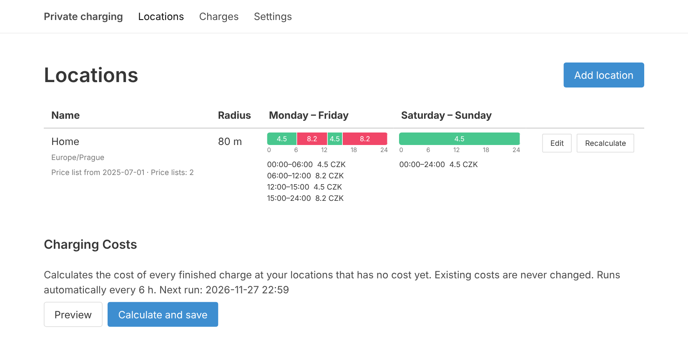
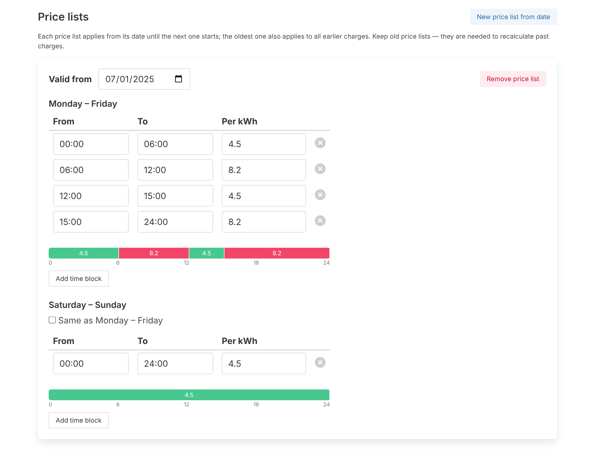
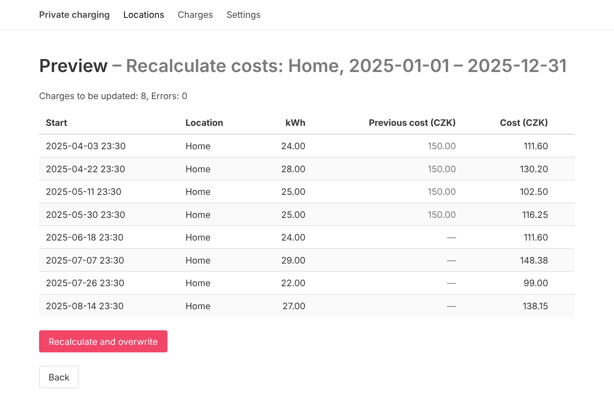

# ⚡ TeslaMate Private Charging Costs

[](LICENSE)
[](https://www.python.org)

Charging costs for your **private chargers** (home, work, cottage, …) in [TeslaMate](https://github.com/teslamate-org/teslamate), with time-of-use tariffs (peak / off-peak, weekends), price lists that change over time, and a simple web page to manage it all.



---

## ✨ Features

| | |
|---|---|
| 🖥 **Web interface** | Runs next to Grafana at `/private-charging`, in TeslaMate's look and in TeslaMate's languages |
| 📍 **Locations from TeslaMate** | Pick one of your TeslaMate geo-fences — name, coordinates and radius are filled in |
| ⏱ **Time-of-use tariffs** | Any number of time blocks with their own price, separately for Monday–Friday and Saturday–Sunday |
| 🗓 **Price lists over time** | A new contract from 1 July? Add a price list valid from that date and keep the old ones as history |
| ↩️ **Recalculate the past** | Price all past charges at a location for a chosen period — e.g. right after installing |
| 🔌 **Accurate** | Uses TeslaMate's charging samples, so scheduled charging (plugged in at 6 pm, charging at night) is priced at the night rate; bills the energy taken from the grid incl. charging losses |
| 💱 **Currencies** | Bill in CZK, show in CHF — converted with the ECB rate of the charging day |
| 🔒 **Safe** | Fills in only charges without a cost; overwriting happens only when you explicitly recalculate, after a preview |
| 📊 **Grafana-ready** | Writes to `charging_processes.cost`, so TeslaMate's dashboards show the costs |

Out of scope: Superchargers and public DC charging (TeslaMate or a dedicated importer handle those).

---

## 🚀 Quick start (Docker)

You need a running TeslaMate stack (Docker Compose). This tool joins its Docker network and reads/writes its database.

**1. Get the code**

```bash
git clone https://github.com/kalich5/teslamate-private-charging-costs.git
```

```bash
cd teslamate-private-charging-costs
```

**2. Configure** — copy the template and set at least `WEB_PASSWORD` and `DATABASE_PASS` (the same password as in your TeslaMate setup):

```bash
cp .env.example .env
```

```bash
nano .env
```

The container joins TeslaMate's Docker network, which Compose calls `<folder>_default` — `teslamate_default` for a stack in a folder named `teslamate`. If yours is different, set `TESLAMATE_NETWORK` in `.env`. Find the name with:

```bash
docker network ls | grep teslamate
```

**3. Create the data folder** (owned by you, so the container — uid 1000 — can write the config):

```bash
mkdir -p data
```

**4. Start**

```bash
docker compose up -d --build
```

**5. Open** `http://<your-server>:4001/private-charging` and log in as `admin` with your `WEB_PASSWORD`.

### First steps

1. **Settings** — check the currency used in TeslaMate and your time zone.
2. **Add location** — pick your TeslaMate geo-fence (e.g. *Home*), set the currency of your electricity bill and enter the price list: time blocks and prices per kWh.
3. Did your prices change in the past? Add a price list for each period with **New price list from date**.
4. **Recalculate** — fill in the costs of your past charges at that location (preview first).
5. From now on new charges are priced automatically every few hours.

---

## 🖥 Using the web interface

### Locations and price lists

Each location has one or more **price lists**. A price list is valid from its date until the next one starts; the oldest one also covers all earlier charges. Keep old price lists — they are your history and are needed to recalculate past charges.



- Times are 24-hour `HH:MM`; the last block ends at `24:00`. A block over midnight (e.g. 22:00–06:00) is entered as 22:00–24:00 and 00:00–06:00.
- **Add time block** splits the last block in two. Changing a block's end moves the next block's start, so the day stays covered.
- The coloured bar shows the day at a glance (green = cheapest, red = most expensive) and marks gaps or overlaps while you type. A price list with gaps or overlaps cannot be saved.
- **Same as Monday – Friday** uses the weekday blocks for the weekend too.
- **New price list from date** copies the current price list, so you only change what changed.
- Tariff times are local times of the location (default time zone in Settings, or one per location). Summer time is handled automatically.

### Charging costs

- **Preview** shows which charges would get a cost; **Calculate and save** writes them.
- The same runs automatically every *N* hours (Settings → *Run automatically every*, default 6; `0` turns it off).
- Only charges **without a cost** are touched. Costs entered in TeslaMate or calculated earlier stay as they are.

### Recalculate

For one location and a date range: preview the previous and the new cost of each charge, then write.



> ⚠️ Recalculation **overwrites all costs** of charges at that location in the selected period — including costs entered in TeslaMate and costs calculated earlier.

### Charges

The last 100 TeslaMate charges with location, energy from the grid, cost and price per kWh — a quick check that everything adds up.

### Language

The same languages as TeslaMate's web app — Catalan, Chinese (simplified and traditional), Czech, Danish, Dutch, English, Finnish, French, German, Hungarian, Italian, Japanese, Korean, Norwegian, Spanish, Swedish, Thai, Turkish and Ukrainian — chosen the same way: **Settings → Language → Web App**, otherwise your browser's language, otherwise English.

---

## ⚙️ Configuration

### Environment variables (`.env`)

| Variable | Default | |
|---|---|---|
| `WEB_PASSWORD` | – | Password for the web interface. **Set it** — without it anyone who can reach the page can change your tariffs. |
| `WEB_USER` | `admin` | User name for the web interface |
| `SECRET_KEY` | random | Signs the session cookie; set it to stay logged in across restarts |
| `DATABASE_HOST` | `database` | TeslaMate's PostgreSQL — same variable names as in TeslaMate |
| `DATABASE_PORT` | `5432` | |
| `DATABASE_NAME` | `teslamate` | |
| `DATABASE_USER` | `teslamate` | |
| `DATABASE_PASS` | `teslamate` | |
| `TESLAMATE_NETWORK` | `teslamate_default` | Docker network of your TeslaMate stack |
| `PRIVATE_COSTS_PORT` | `4001` | Port on the host |
| `ROOT_PATH` | `/private-charging` | URL path of the web interface |

### `config.yaml`

Everything you set in the web interface is stored in `data/config.yaml` (a `.bak` copy of the previous version is kept). You can also edit it by hand — comments are not preserved when saving from the web interface.

```yaml
BASE_CURRENCY: CZK          # currency of the costs in TeslaMate
TIMEZONE: Europe/Prague     # tariff times are local times in this zone
SCHEDULE_HOURS: 6           # automatic run interval, 0 = off

LOCATIONS:
  - name: Home
    lat: 49.1951
    lon: 16.6068
    radius_m: 80
    currency: CZK            # currency of your electricity bill
    # timezone: Europe/Prague   # optional, overrides TIMEZONE

    tariffs:                 # price lists
      - valid_from: 2024-01-01
        weekday:             # Monday–Friday
          - { from: "00:00", to: "06:00", price: 4.1 }   # off-peak
          - { from: "06:00", to: "12:00", price: 7.4 }   # peak
          - { from: "12:00", to: "15:00", price: 4.1 }
          - { from: "15:00", to: "24:00", price: 7.4 }
        weekend:             # Saturday–Sunday
          - { from: "00:00", to: "24:00", price: 4.1 }

      - valid_from: 2025-07-01                           # new contract
        weekday:
          - { from: "00:00", to: "06:00", price: 4.5 }
          - { from: "06:00", to: "24:00", price: 8.2 }
        weekend:
          - { from: "00:00", to: "24:00", price: 4.5 }
```

Rules:

- Prices are per kWh in the location's `currency`.
- Blocks are `[from, to)` — `06:00` belongs to the block that starts at 06:00 — and must cover 00:00–24:00 without gaps or overlaps.
- A price list applies from 00:00 local time on its `valid_from` date. Two price lists cannot start on the same day.
- The configuration is validated before saving and before every run, so no charge is ever written with a partial cost.

### Behind a reverse proxy (next to Grafana)

To serve the page at e.g. `https://teslamate.example.com/private-charging`, route that path to the container and keep the prefix — the app itself lives under `/private-charging` (change it with `ROOT_PATH`).

nginx:

```nginx
location /private-charging/ {
    proxy_pass http://127.0.0.1:4001;
    proxy_set_header Host $host;
    proxy_set_header X-Forwarded-Proto $scheme;
}
```

Traefik (labels on the `private-costs` service, like in TeslaMate's Traefik guide):

```yaml
    labels:
      - "traefik.enable=true"
      - "traefik.http.routers.private-costs.rule=Host(`teslamate.example.com`) && PathPrefix(`/private-charging`)"
      - "traefik.http.routers.private-costs.entrypoints=websecure"
      - "traefik.http.routers.private-costs.tls.certresolver=tmhttpchallenge"
      - "traefik.http.services.private-costs.loadbalancer.server.port=4001"
```

If the proxy already asks for a password (e.g. TeslaMate's basic-auth middleware), you can leave `WEB_PASSWORD` empty and remove the `ports:` mapping from `docker-compose.yml`, so the page is reachable only through the proxy.

### Command line

The importer can also be run without the web interface:

```bash
docker compose run --rm private-costs python importer.py --dry-run
```

| Option | |
|---|---|
| `--dry-run`, `-n` | Show what would be written, change nothing |
| `--recalculate LOCATION --from YYYY-MM-DD [--to YYYY-MM-DD]` | Recalculate (and **overwrite**) all costs at a location in a period |
| `--config FILE`, `-c` | Config file (default: `$CONFIG_PATH` or `config.yaml`) |
| `--verbose`, `-v` | Also log skipped charges |

---

## 🧠 How it works

```
TeslaMate database
  └─ finished charges without a cost (or a chosen period when recalculating)
        │
        ▼
  match the charge's position to a location (radius)
        │
        ▼
  spread the energy over time using TeslaMate's charging samples
  (waiting for scheduled charging or pauses get no energy)
        │
        ▼
  price every minute with the price list and time block valid then (local time)
        │
        ▼
  convert to TeslaMate's currency (ECB rate of the charging day)
        │
        ▼
  UPDATE charging_processes SET cost = …
```

- **Energy**: the cost is based on `charge_energy_used` — energy taken from the grid, including charging losses, i.e. what your meter measures. If it is missing, `charge_energy_added` is used.
- **Currency**: rates come from the free [Frankfurter API](https://frankfurter.dev/) (ECB reference rates) with EUR as the pivot. On weekends and holidays the last published rate is used.

---

## 📊 Grafana examples

Average price per kWh from the grid, by month:

```sql
SELECT
  date_trunc('month', start_date) AS time,
  ROUND(SUM(cost) / NULLIF(SUM(GREATEST(charge_energy_used, charge_energy_added)), 0), 2) AS "price per kWh"
FROM charging_processes
WHERE cost IS NOT NULL
GROUP BY 1
ORDER BY 1
```

Cost per 100 km (assuming ~18 kWh/100 km from the battery):

```sql
SELECT
  ROUND(SUM(cost) / NULLIF(SUM(charge_energy_added), 0) * 18, 2) AS "cost per 100 km"
FROM charging_processes
WHERE cost IS NOT NULL
```

---

## 🌍 Translations

Translations live in `translations/<language>/LC_MESSAGES/messages.po` (gettext); English is the source language. Corrections are very welcome — apart from Czech, the translations have not been reviewed by native speakers yet.

After editing a `.po` file, compile it:

```bash
pybabel compile -d translations
```

After changing texts in the code or templates, update all catalogs first:

```bash
pybabel extract -F babel.cfg --no-location --sort-output -o translations/messages.pot .
```

```bash
pybabel update -i translations/messages.pot -d translations --no-location
```

---

## 🧩 Development

```
web.py             Web interface and scheduler (default container command)
importer.py        Importer — reads charges, prices them, writes costs; also the CLI
pricing.py         Price lists and minute-by-minute cost calculation
geo.py             Matching positions to locations (Haversine distance)
fx.py              Currency conversion (Frankfurter API, cached)
i18n.py            Language selection (same rules and languages as TeslaMate)
config_store.py    Reading and writing config.yaml
templates/         Pages (Jinja)
static/            Bundled Bulma CSS, styles, editor JavaScript
translations/      Translations (.po/.mo), babel.cfg for extraction
tests.py           Tests of the calculation
tests_web.py       Tests of the web interface, recalculation and translations
config.yaml        Example configuration
```

Run the tests:

```bash
pip install -r requirements.txt pytest
```

```bash
pytest tests.py tests_web.py
```

---

## 🔒 Safety

- **No silent overwrites** — the normal run fills in only charges without a cost. Only an explicit recalculation overwrites costs, for one location and a chosen period, after a preview.
- **Validated before saving** — price lists with gaps or overlaps are refused, so no charge gets a partial cost.
- **Login and CSRF protection** for the web interface.
- **Non-root container.**

---

## 🔮 Roadmap

- [ ] Home Assistant / HDO integration (automatic tariff switching)
- [ ] Grafana dashboard templates
- [ ] NT-savings optimizer
- [ ] Fallback flat rate for unknown locations

---

## 🤝 Contributing

Pull requests are welcome!

- Keep the code simple and readable
- Add tests and log anything that can fail silently
- Test with a real TeslaMate instance before submitting

---

## 📄 License

MIT License — see [LICENSE](LICENSE).
